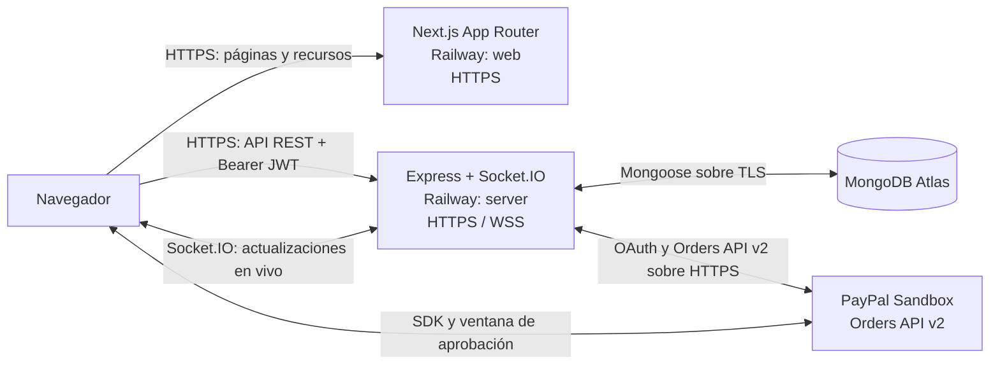

# LibroYa — Product Requirements Document

**Versión:** 1.0  
**Estado:** producto implementado, desplegado para pruebas  
**URL pública:** https://web-production-eefb95a1.up.railway.app

## 1. Resumen ejecutivo

LibroYa es una librería en línea para explorar y comprar libros físicos y ebooks. Los clientes pueden crear una cuenta, administrar un carrito, pagar mediante PayPal Sandbox, consultar pedidos y descargar ebooks adquiridos. El administrador mantiene el catálogo y el inventario y actualiza los despachos en un tablero Kanban.

### Problema

Una librería necesita vender dos tipos de productos con reglas distintas: los libros físicos tienen existencias y requieren dirección de entrega; los ebooks no consumen stock ni requieren envío. Además, los clientes necesitan consultar el estado de sus pedidos sin recargar la página y el administrador necesita una forma visual de operar los despachos.

### Objetivos

- Permitir que visitantes consulten libros, categorías, precios y disponibilidad.
- Permitir que clientes se registren, compren y consulten sus pedidos y ebooks.
- Calcular importes y validar el inventario en el servidor.
- Permitir que el administrador gestione catálogo, stock y estados de envío.
- Reflejar cambios de inventario y despacho en las pantallas abiertas mediante Socket.IO.

## 2. Actores y permisos

| Actor | Permisos disponibles |
|---|---|
| **Visitante** | Consultar inicio, catálogo y detalles de libros; filtrar y buscar; agregar libros al carrito local. Las rutas de carrito y checkout requieren iniciar sesión. |
| **Cliente** | Acceder a las funciones de visitante; crear pedidos, pagar los propios, consultar su historial y descargar ebooks de pedidos pagados propios. |
| **Administrador** | Consultar y modificar el catálogo, activar o desactivar libros, ajustar stock físico, ver alertas de stock bajo y administrar el tablero de envíos. Puede consultar pedidos para la operación de despacho. |

El registro público siempre crea una cuenta `cliente`; el formulario no permite elegir el rol. La interfaz redirige a los administradores fuera de las rutas de cliente. La API de creación de pedidos actualmente acepta tanto `cliente` como `admin`, aunque el checkout de la interfaz está protegido para el rol cliente.

## 3. Arquitectura

- **Frontend y backend separados:** Next.js entrega la interfaz; Express concentra las rutas REST y la lógica de negocio. El navegador llama a la API del servicio `server`.
- **JWT Bearer:** el backend valida el JWT recibido en `Authorization: Bearer …`. El frontend guarda el token en `localStorage`. La cookie `libroya_role` solo ayuda al middleware de Next.js a decidir redirecciones; no contiene el JWT y no reemplaza la autorización de la API.
- **Socket.IO junto a Express:** Socket.IO comparte el mismo servidor HTTP y proceso que Express. El servidor autentica el handshake si recibe un token y decide la asignación de salas.
- **Stock atómico:** durante la captura, el backend descuenta stock físico mediante una actualización condicional (`stock >= cantidad`) antes de solicitar el cobro. Si falta stock o falla la captura, restituye lo descontado.

## 4. Alcance funcional implementado

### 4.1 Acceso público

- Página de inicio con enlaces a categorías, catálogo y libros destacados.
- Catálogo público y detalle de cada libro.
- Indicadores de inventario: **Disponible**, **Quedan N**, **Agotado** o **Descarga inmediata**.
- El público no recibe la URL privada del archivo de ebook desde las respuestas del catálogo o del detalle.

### 4.2 Autenticación

- Registro con nombre, correo, contraseña y confirmación; contraseña mínima de 8 caracteres.
- Login y cierre de sesión.
- Al intentar entrar a una ruta protegida sin sesión, la interfaz redirige a `/login` y conserva la ruta de retorno.
- La sesión se rehidrata al cargar la aplicación; una respuesta 401 limpia la sesión.

### 4.3 Catálogo y filtros

- Búsqueda por título o autor.
- Filtros por categoría (`Novela`, `Ciencia`, `Historia`, `Infantil`, `Tecnología`, `Poesía` y `Otro`) y formato (`fisico` o `ebook`).
- El administrador autenticado puede consultar también libros inactivos; el listado público limita los resultados a libros activos.
- La página de detalle presenta formato, categoría, precio, disponibilidad y sinopsis.

### 4.4 Carrito y dirección

- El carrito se mantiene en `localStorage` del navegador y permite cambiar cantidades, quitar artículos y vaciarlo.
- El resumen muestra subtotal, costo de envío estimado y total estimado.
- Los pedidos con libros físicos requieren nombre, dirección, ciudad y teléfono; las notas son opcionales.
- Los pedidos compuestos solo por ebooks no requieren dirección y no tienen costo de envío.

### 4.5 Checkout y pagos

- El checkout presenta los artículos y el resumen en USD.
- PayPal Buttons usa PayPal Sandbox con intención de captura.
- La aplicación crea primero un pedido pendiente en la API, solicita una orden a PayPal desde el backend y, tras la aprobación, pide al backend capturar y verificar el pago.
- Al confirmar un pedido pagado que contiene libros físicos, el estado del envío comienza en **Pendiente** y se registra su historial inicial.
- Al completar el pago, se vacía el carrito y la interfaz navega al historial con un mensaje de confirmación.
- El frontend muestra errores de validación, cancelación o problemas de comunicación con PayPal.

### 4.6 Historial y biblioteca

- **Mis pedidos** presenta fecha, artículos, cantidades, precios guardados, subtotal, envío, total, estado de pago y, si aplica, dirección y estado del despacho.
- **Mi biblioteca** lista ebooks de pedidos pagados del usuario autenticado y ofrece el enlace de descarga.
- La URL de descarga se consulta solo para los ebooks incluidos en pedidos pagados del usuario autenticado.

### 4.7 Gestión de catálogo y stock (admin)

- Tabla de libros con formato, categoría, precio, stock y estado activo/inactivo.
- Formulario para crear y editar título, autor, ISBN, descripción, categoría, formato, precio, portada, umbral de stock, archivo de ebook y estado.
- El administrador puede activar o desactivar libros; no hay acción de borrado en la interfaz.
- Para libros físicos, controles de incremento/decremento y ajuste de stock.
- Pestaña de alertas para libros físicos activos cuyo stock es menor o igual al umbral.
- Los ebooks se muestran como productos digitales sin stock.

### 4.8 Tablero Kanban y tiempo real

- El tablero admin organiza pedidos pagados con libros físicos en cuatro columnas: **Pendiente**, **Preparando**, **Enviado** y **Entregado**.
- Se puede arrastrar una tarjeta únicamente a la siguiente columna permitida. Si la API rechaza el cambio, la interfaz revierte la actualización optimista y muestra un mensaje.
- El cliente recibe una notificación en **Mis pedidos** cuando cambia el estado de su envío. Los administradores reciben nuevos pedidos físicos pagados y cambios de estado en el tablero.
- Los cambios de stock se difunden para que catálogo, detalle y gestión de inventario actualicen su disponibilidad. La interfaz vuelve a solicitar datos al reconectarse.

## 5. Historias de usuario y criterios de aceptación

### HU-01 — Explorar libros sin cuenta

**Como visitante**, quiero explorar la librería y sus libros para decidir qué leer.

- Al abrir la URL pública, se muestran el encabezado de LibroYa, categorías y una sección de libros destacados.
- Al entrar al catálogo, aparecen libros activos y controles para búsqueda, categoría y formato.
- Al seleccionar filtros, la URL refleja los parámetros y la lista coincide con ellos.
- Si no hay coincidencias, se muestra el mensaje de que no se encontraron libros y una acción para ver todos.

### HU-02 — Consultar disponibilidad y agregar al carrito

**Como visitante o cliente**, quiero ver el estado de un libro y agregarlo al carrito.

- La ficha de un libro muestra título, autor, formato, categoría, precio en USD y disponibilidad.
- Un libro físico agotado muestra **Agotado** y no ofrece acción para agregarlo.
- Un ebook muestra **Descarga inmediata**; un físico con stock igual o menor al umbral muestra **Quedan N**.
- Al agregar un libro disponible, se muestra la confirmación **Agregado al carrito** y el carrito refleja el artículo.

### HU-03 — Crear una cuenta cliente

**Como visitante**, quiero registrarme para poder comprar.

- El formulario solicita nombre, correo, contraseña y confirmación.
- Una diferencia entre contraseña y confirmación muestra un error y no crea la cuenta.
- Una contraseña menor a 8 caracteres muestra un error.
- Tras un registro válido, la interfaz inicia la sesión y lleva al inicio; la cuenta queda con rol cliente.

### HU-04 — Iniciar sesión y volver a la ruta solicitada

**Como usuario registrado**, quiero iniciar sesión y continuar donde estaba.

- Un visitante que abre una ruta protegida es llevado a `/login` con la ruta solicitada como `redirect`.
- Un login correcto guarda la sesión y devuelve al usuario a la ruta de retorno (o al inicio si no había una).
- Credenciales incorrectas muestran un mensaje de error y no autentican.
- Al cerrar sesión, se limpia la sesión y se vuelve al inicio.

### HU-05 — Administrar el carrito y revisar el envío

**Como cliente**, quiero ajustar mis artículos y conocer el costo estimado.

- Puedo aumentar o disminuir cantidades, quitar un artículo y vaciar el carrito.
- El subtotal y el total estimado se actualizan con el contenido del carrito.
- Si hay al menos un libro físico, el resumen muestra envío de **USD 4.99** y avisa que se solicitará una dirección.
- Si el carrito contiene solo ebooks, muestra envío gratis y que no se requiere dirección.
- Con el carrito vacío, aparece el estado vacío y un enlace al catálogo.

### HU-06 — Completar checkout

**Como cliente**, quiero confirmar mi pedido y pagar con PayPal Sandbox.

- Para un pedido físico, checkout presenta los campos requeridos de nombre completo, dirección, ciudad y teléfono; las notas son opcionales.
- Para un pedido solo de ebooks, no solicita dirección física.
- El resumen muestra artículos, subtotal, costo de envío y total en USD.
- Al aprobar PayPal, el pedido aparece en **Mis pedidos** como pagado y el carrito queda vacío.
- Al cancelar el popup o recibir un error, se muestra el mensaje correspondiente y no se presenta el pedido como pagado.

### HU-07 — Consultar pedidos y seguimiento

**Como cliente**, quiero consultar mis compras y el progreso de mis envíos.

- **Mis pedidos** muestra el estado de pago de cada pedido y, para pedidos físicos, su estado de envío.
- Los artículos muestran el precio unitario guardado al crear el pedido, no un precio recalculado en la pantalla.
- Al recibir una actualización de envío, cambia el estado y aparece una notificación visible.
- Si la conexión Socket.IO se recupera, la pantalla vuelve a sincronizar los pedidos.

### HU-08 — Descargar un ebook comprado

**Como cliente**, quiero acceder a los ebooks que ya pagué.

- Si no hay ebooks pagados, la biblioteca muestra un estado vacío y un enlace al catálogo de ebooks.
- Si hay ebooks pagados, cada tarjeta muestra título, autor y un botón **Descargar EPUB**.
- La biblioteca no debe listar ebooks de pedidos pendientes ni de otros usuarios.

### HU-09 — Gestionar catálogo y stock

**Como administrador**, quiero mantener actualizado el catálogo y las existencias.

- En `/admin/catalogo`, la tabla muestra libros, formato, precio, stock y estado.
- Puedo abrir el formulario para crear o editar un libro y ver el resultado en la tabla tras guardar.
- Puedo desactivar un libro y comprobar que su estado cambia a inactivo.
- Para un libro físico, puedo aumentar o reducir stock y comprobar el nuevo valor.
- La pestaña de stock bajo contiene solo libros físicos activos que cumplen `stock <= umbral`.
- Al cambiar stock, las vistas abiertas reflejan el nuevo inventario mediante tiempo real.

### HU-10 — Operar despachos

**Como administrador**, quiero mover pedidos pagados físicos por las etapas de envío.

- El tablero muestra las cuatro columnas y cuenta las tarjetas por estado.
- Un pedido recién pagado que contiene libros físicos aparece en **Pendiente**.
- Puedo moverlo solo un paso hacia adelante; un destino no permitido muestra un aviso y no cambia su estado.
- Si la API rechaza una transición, el tablero restaura el estado anterior.
- Los demás clientes y administradores conectados reciben la actualización del estado.

### HU-11 — Restringir rutas por rol

**Como usuario**, quiero que las funciones privadas respeten mi rol.

- Un visitante que abre `/carrito`, `/checkout`, `/mis-pedidos` o `/mi-biblioteca` es redirigido al login.
- Un usuario cliente que abre `/admin/...` es redirigido al inicio.
- Un administrador que abre una ruta de cliente es llevado al panel de catálogo.
- Las llamadas directas a endpoints protegidos sin Bearer válido reciben 401; las llamadas sin rol requerido reciben 403.

## 6. Reglas de negocio y seguridad verificables

1. **Precio autoritativo:** al crear un pedido, el cliente envía identificador y cantidad; el servidor obtiene título, formato y precio de MongoDB y guarda una copia en cada línea. Manipular un precio en el navegador no debe alterar el total.
2. **Inventario:** solo se valida o descuenta stock de libros `fisico`. Ebooks no consumen stock; al crear el pedido el servidor normaliza su cantidad a 1.
3. **Dirección y envío:** nombre, calle, ciudad y teléfono son obligatorios si hay físicos. El costo es USD 4.99 si hay al menos un físico y USD 0 si el pedido solo contiene ebooks.
4. **Captura verificada:** un pedido se marca pagado solo tras una captura PayPal `COMPLETED` que corresponde al pedido y cuyo importe y moneda coinciden exactamente con el total en USD. Un pedido físico inicia su envío en `PENDIENTE`.
5. **Stock atómico y reversión:** el backend descuenta antes de capturar. Si el stock no alcanza, no cobra; si falla la captura o su verificación, devuelve el stock descontado.
6. **Idempotencia:** capturar un pedido ya pagado devuelve el resultado conocido, en vez de tratarlo como un segundo pago.
7. **Propiedad del pedido:** un cliente solo puede consultar y pagar sus pedidos propios. Un administrador puede consultar pedidos para la gestión.
8. **Transiciones de envío:** solo pedidos pagados con productos físicos pueden entrar al flujo. Se permite únicamente `PENDIENTE → PREPARANDO → ENVIADO → ENTREGADO`; no se permite saltar ni retroceder.
9. **Ebooks:** las respuestas públicas de catálogo/detalle excluyen `ebookFileUrl`. La biblioteca solo obtiene esa URL para ebooks incluidos en pedidos pagados del usuario autenticado.
10. **Autenticación y datos de pago:** las contraseñas se guardan con hash bcrypt; el JWT se valida en cada endpoint protegido. La API limita CORS al origen configurado y el manejador de errores no entrega detalles internos de errores 500 en producción. La aplicación no almacena datos de tarjetas.
11. **Tiempo real:** los sockets con token inválido son rechazados; los sockets anónimos pueden recibir eventos públicos de stock. Las salas `admins` y `user:<id>` las asigna el servidor, no el navegador.

## 7. Datos de prueba

- **Interfaz:** https://web-production-eefb95a1.up.railway.app
- **Cliente demo:** `cliente@libroya.com` / `Cliente123!`
- **Administrador demo:** `admin@libroya.com` / `La contraseña de administrador se entrega en el informe del laboratorio`
- Estas cuentas y los 16 libros (8 físicos y 8 ebooks) están definidos por el script de seed. Para que estén disponibles en el entorno de prueba, el seed debe haberse ejecutado contra la base de datos de ese entorno.
- Libros físicos del seed que deben permitir comprobar alertas:
  - **Sapiens: De animales a dioses** — stock 2; umbral 3.
  - **El principito** — stock 1; umbral 3.
  - **Cosmos** — stock 3; umbral 3 (en el umbral de alerta).
  - **Veinte poemas de amor y una canción desesperada** — stock 0; agotado.

### Requisito para completar una compra

Para completar un pago, el usuario debe iniciar sesión en la ventana emergente de PayPal Sandbox con una **cuenta compradora de prueba**. Esa cuenta no se incluye en este documento; debe obtenerse/configurarse por separado en PayPal Developer Sandbox.

## 8. Fuera de alcance y limitaciones conocidas

- Pagos reales, facturación e impuestos, cupones, notificaciones por correo o SMS, rastreo GPS, devoluciones y reembolsos, múltiples idiomas y aplicación móvil nativa.
- Los pagos están configurados para PayPal Sandbox; no se procesan cobros reales.
- Socket.IO no usa adaptador Redis. La aplicación está planteada para una sola instancia de backend; varias instancias no comparten salas ni eventos en tiempo real.
- Los datos de demo dependen de que el script de seed se ejecute en la base de datos del entorno que se va a probar.
- El catálogo administra la disponibilidad del ebook mediante enlaces externos; no incluye almacenamiento propio de archivos digitales.
